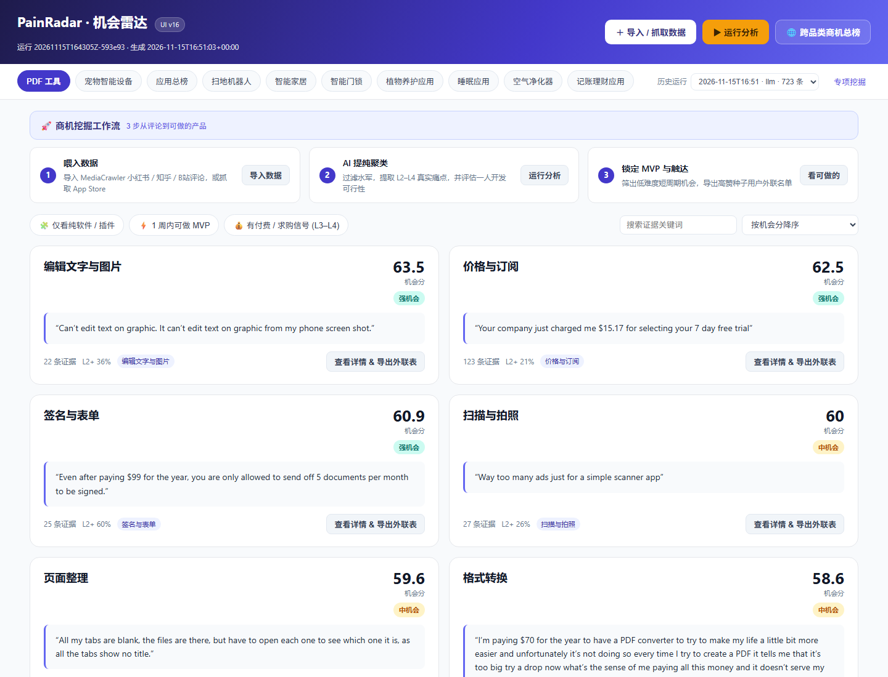
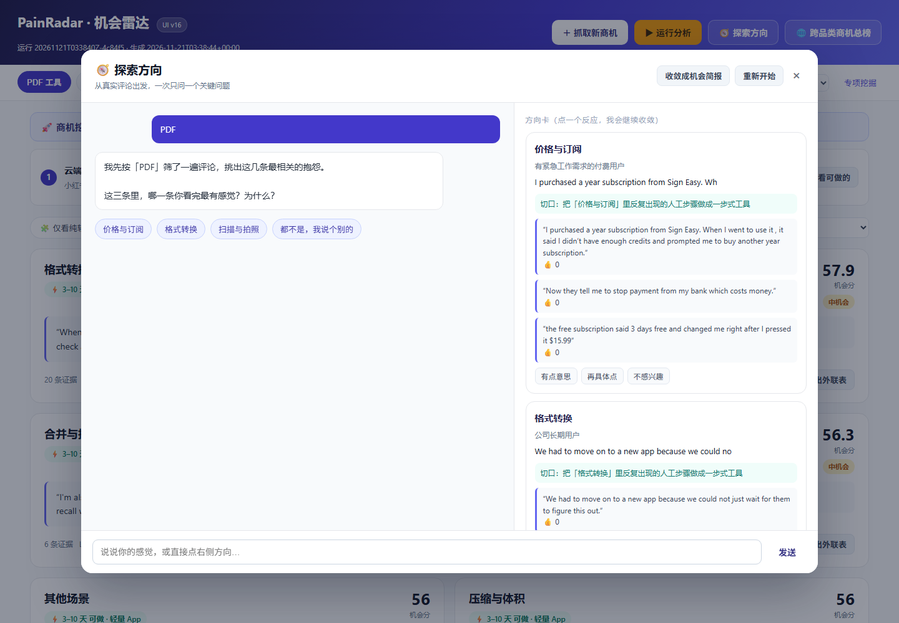

# PainRadar 痛点雷达

把公开评论加工成**可追溯、可验证、可打分**的产品机会卡。

本仓库是《PainRadar 开发方案》的 M0/M1 落地：一条能跑通的垂直切片——从评论导入、脱敏去重、痛点原子抽取（带原文锚定）、语义聚类、双因子评分、市场区间估算，到机会卡与 Markdown/DOCX 报告，全部离线可运行，不依赖任何 API Key。

```
评论(JSONL/CSV) → 脱敏去重 → 痛点原子(span 锚定) → 语义聚类(canonical 优先) → 评分 → 市场区间 → 机会卡 → 报告
                                  ↑ 证据台账（append-only，可回源、可删除） ↑
```

---

## 1. 快速开始

要求：Python 3.11+（已在 3.12 验证）。CLI 与管线只用标准库；
HTTP 界面需要 `pip install -r requirements.txt`（fastapi + uvicorn），DOCX 导出可选 python-docx。

```powershell
cd PainRadar

# 环境自检
python run.py doctor

# 端到端演示：3 个品类、80 条样例评论、生成 3 份报告
python run.py demo --reset --docx

# 交互式界面（可选）
pip install -r requirements.txt
python run.py serve --db var\gold200.db --db var\gold.db
```

输出：

```
reports/demo/pet_water_fountain-<run>.md / .docx
reports/demo/home_storage-<run>.md / .docx
reports/demo/camping_gear-<run>.md / .docx
```

> 演示报告写到 `reports/demo/`，不会覆盖你用真实数据生成的 `reports/` 报告。

### 用真实数据跑一遍

```powershell
# 1) 从 App Store 搜索并抓取评论（公开 RSS，无需 Key）
python run.py --db var/live.db fetch --source appstore `
    --category pet_water_fountain --search "cat water fountain" --pages 2

# 2) 抓一个外部锚（评分人数 / 平均分），用于计算样本覆盖率
python run.py --db var/live.db anchor --source itunes `
    --category pet_water_fountain --app-id 1586120661

# 3) 抽取 → 聚类 → 评分 → 出报告
python run.py --db var/live.db run --category pet_water_fountain
python run.py --db var/live.db report --category pet_water_fountain --docx
```

Reddit 需要 OAuth（公开 JSON 对未认证请求经常超时/403）：

```powershell
$env:REDDIT_CLIENT_ID="..."; $env:REDDIT_CLIENT_SECRET="..."
$env:REDDIT_USERNAME="..."; $env:REDDIT_PASSWORD="..."
$env:REDDIT_USER_AGENT="PainRadar/0.1 by <your-reddit-username>"
python run.py --db var/live.db fetch --source reddit `
    --category pet_water_fountain --query "fountain noise" --subreddits catadvice --limit 10
```

### 用 LLM 抽取器（可选）

任何 OpenAI 兼容端点都可以（DeepSeek / Qwen / vLLM / Ollama）：

```powershell
$env:PAINRADAR_LLM_BASE_URL="https://api.deepseek.com/v1"
$env:PAINRADAR_LLM_API_KEY="sk-..."
$env:PAINRADAR_LLM_MODEL="deepseek-chat"

python run.py --db var/live.db run --category pet_water_fountain --extractor llm
```

**默认单跑 + 思维链（CoT）**：模型先输出 `reasoning` 再抽取，配合原文三道闸
（exact / normalized / fuzzy）校验，成本约为原来的 50%。需要更强的稳定性时再加：

```bash
python run.py run --category pet_water_fountain --extractor llm --double-run
```

`--double-run` 会以更高温度再跑一次并做一致性比对，token 翻倍；
单跑模式下锚定失败仍会自动回退规则抽取器，不会产生无出处的原子。

没有 Key 也能验证链路——仓库自带一个确定性假端点：

```powershell
python tools/fake_llm.py --port 8765
python run.py --db var/llm.db run --category pet_water_fountain `
    --extractor llm --llm-base-url http://127.0.0.1:8765 --llm-model fake
```

LLM 抽取不是"信模型"：每条结果都要过原文锚定（exact / normalized / fuzzy 三道闸）。
默认**单跑 + 思维链**：模型先写 `reasoning` 说明用户的目标与阻碍，再输出结构化字段，
成本约为旧双跑模式的一半；锚定失败自动回退规则抽取器，回退比例写进 `stats.extraction`。
需要更强一致性时加 `--double-run`（第二次温度 +0.3，token 翻倍）。

### 导入 MediaCrawler 导出的国内平台数据

```bash
# 小红书 / B站 / 知乎 / 抖音 的 JSON、JSONL 或 CSV
python run.py --db var/media.db ingest \
  --source mediacrawler \
  --category pet_water_fountain \
  --file data/xhs_export.json

# 字段名对不上时，用映射文件覆盖
python run.py ingest --source mediacrawler --category pet_water_fountain \
  --file data/xhs_export.json --field-map mapping.json
```

连接器会自动识别字段、保留「原帖标题 + 正文 + 高赞评论 + 楼中楼」上下文，
并按评论点赞数入库；过短 / 纯表情 / 广告评论在入库前丢弃。

### 聚类与机会卡（2026-11 升级）

- **语义优先聚类**：先按模型给出的 `canonical_pain`（4–12 字需求短语）分桶，
  再把语义相近的桶合并；`scene` 只在模型没给出短语时作兜底。
  新赛道不配场景词典也能聚出痛点簇。
- **一人开发可行性**：每张机会卡带 `solo_dev_feasibility`
  （难度 / MVP 周期 / 产品形态 / 变现），硬件或重运营需求会被降权。
- **种子用户外联**：WebUI 下钻抽屉可导出 `outreach.csv`
  （仅 L2–L4，按点赞降序，含自动生成的破冰话术），用于第一轮私信/评论触达。

## 2. 命令

| 命令 | 作用 |
|---|---|
| `python run.py doctor` | 检查运行环境、样例、凭据与依赖 |
| `python run.py demo [--reset] [--docx]` | 跑通三个品类的完整链路并出报告 |
| `python run.py fetch --source appstore --category X --search "..."` | 从 App Store 搜索并抓取评论（公开 RSS） |
| `python run.py fetch --source reddit ...` | 从 Reddit 抓取（OAuth 或公开 JSON；本机不可达） |
| `python run.py fetch --source github --category X --query "petkit"` | GitHub Issues 公开搜索（集成/固件问题） |
| `python run.py fetch --source hn --category X --query "water fountain"` | Hacker News 评论（Algolia） |
| `python run.py anchor --source itunes --category X --app-id N` | 写入评分人数/平均分锚 |
| `python run.py anchor --source file --category X --file anchors.csv` | 从 CSV 导入价格/BSR/广告数等锚 |
| `python run.py ingest --category X --file data.jsonl` | 导入 BYOD 文件 |
| `python run.py run --category X` | 抽取 → 聚类 → 评分 → 机会卡 |
| `python run.py discover --db var\gold.db --db var\gold200.db` | **无品类发现**：丢掉品类标签，跨域合并簇并排序需求 |
| `python run.py discover --canonical ...` | 先做需求归一化（LLM）再合并，跨域率从 1/11 提到 5/6 |
| `python run.py report --category X --docx` | 为最近一次 run 出报告 |
| `python run.py stats` | 台账统计与最近 runs |
| `python run.py delete --uid cm_xxx` | 级联删除一条评论及其派生原子（PIPL/GDPR） |

`run` 支持 `--extractor rule|llm`、`--threshold`、`--min-size`。
`discover` 的结果与限制见 [docs/discovery-notes.md](docs/discovery-notes.md)；
加 `--canonical` 后的效果见 [docs/discovery-canonical-notes.md](docs/discovery-canonical-notes.md)；
全量 LLM 抽取后的最终结果见 [docs/discovery-full-notes.md](docs/discovery-full-notes.md)；
需求表 v2 已冻结，清单与用法见 [docs/demand-taxonomy-v2.md](docs/demand-taxonomy-v2.md)；
跨类目验证（App Store 总榜 40 个 App）见 [docs/topcharts-notes.md](docs/topcharts-notes.md)。
非 App 渠道（GitHub Issues + Hacker News）见 [docs/community-notes.md](docs/community-notes.md)。
买家访谈执行指南见 [docs/interview-guide.md](docs/interview-guide.md)（含前 3 条需求的提纲，可生成）。
硬件品类补充（扫地机器人/空气净化器/智能门锁）见 [docs/hardware-notes.md](docs/hardware-notes.md)。
Reddit 经 Arctic Shift 存档打通（直连 403）见 [docs/reddit-notes.md](docs/reddit-notes.md)。
数据来源与审计（哪个库从哪来、抓了多少、何时抓的）见 [docs/data-provenance.md](docs/data-provenance.md)。
Google Trends 集成（无官方 API，Cookie + 内部接口）见 [docs/trends-notes.md](docs/trends-notes.md)。
锚 CSV 列：`metric,value[,source,as_of,url,grade,note]`（例如 `rating_count`、`price`、`bsr`、`ad_count`）。

---

## 3. 看看效果

把任意一次运行渲染成单文件 HTML（无服务器、无 JS 依赖，双击即开）：

```powershell
python tools/build_html.py --db var/gold200.db --category pet_water_fountain --out reports/ui-demo.html
```

截图：`reports/ui-demo-v2.png`（修复后：宠物智能设备 · LLM，证据带来源 App）、
`reports/ui-demo.png`（修复前，可对比）、`reports/ui-budgeting.png`（记账 · 规则抽取）。
页面包含：分母与噪声率、一页结论、机会卡（痛感/机会分、因子条、原文证据、人群、替代方案、
梯子分布、SOM 区间）、风险提示、外部锚。

数据质量修复（2026-11-14）：
- 移除了混入的宠物保险 App（Pet Cloud，44 条），`CategorySpec.excluded_apps` + `tools/purge_apps.py`；
- 品类更名为「宠物智能设备」（语料含饮水机/喂食器/猫砂盆/摄像头，原名不准）；
- 证据显示来源 App（Petlibro / PETKIT / Furbo…）；
- 没有人群证据时不再编造「该品类用户」，改为「用户」/「待补」。

### 交互式界面（FastAPI + 前端）

```powershell
pip install -r requirements.txt
python run.py serve --db var\gold200.db --db var\gold.db --port 8770
# 打开 http://127.0.0.1:8770/
```

**界面（UI v16）**：

- 顶栏只保留 3 个主操作：`＋ 导入/抓取数据`、`▶ 运行分析`、`🌐 跨品类商机总榜`；
- 品类切换移到独立二级栏，全部显示中文名，支持横向滚动；右侧「历史运行」可切旧 run；
- 顶部可折叠「🚀 商机挖掘工作流」，三步按钮直达导入 / 运行 / 筛选；
- 机会卡双列网格：痛点标题 + 一人开发徽章 + 机会分 + 最高赞原话 + 证据数 / L2+ 占比；
- 快捷筛选胶囊：纯软件、1 周内 MVP、L3–L4 付费信号；排序支持机会分 / 点赞 / 难度；
- 下钻抽屉顶部就是「⬇ 导出种子用户外联表 (CSV)」，只含 L2–L4，按点赞降序，附破冰话术。



**导入 MediaCrawler**：顶栏「＋ 导入 / 抓取数据」→ 选文件路径与品类即可入库；
也可用 `POST /api/ingest`（详见下表）。

API（OpenAPI 文档在 `/docs`）：

| 方法 | 路径 | 说明 |
|---|---|---|
| GET | `/api/health` | 健康检查 |
| GET | `/api/runs` | 所有运行（含 `latest_for_category`） |
| GET | `/api/runs/{run_id}` | 运行详情 + 机会卡（首屏 12 条证据） |
| GET | `/api/runs/{run_id}/members` | 证据分页（`cluster_id`、`offset`、`limit`） |
| GET | `/api/anchors` | 品类外部锚 |
| POST | `/api/ingest` | 导入 MediaCrawler 文件 `{file, category, min_len}`（202） |
| GET | `/api/runs/{run_id}/clusters/{cluster_id}/outreach.csv` | 种子用户外联 CSV（L2–L4，按赞降序） |
| GET | `/api/discovery` | 最新一次需求发现快照（无则 404） |
| POST | `/api/run` | 触发一次运行 `{category, extractor}`（202 + job） |
| GET | `/api/run/{job_id}` | 作业状态（`queued/running/done/failed`） |
| GET | `/api/run/active` | 当前运行的作业（无则 null） |
| POST | `/api/categories/custom` | 新建品类并抓取 `{name, term, pages}`（202 + job） |

截图：`reports/api-default.png`、`reports/api-drawer.png`。

离线单文件仍保留（无服务、可邮件发送）：

```powershell
python tools/build_app.py --db var/gold200.db --db var/gold.db --out reports/app.html
```

**边界**：目前是只读查看器 + API，没有账号、权限、任务队列和写操作。
多租户与审核流仍在路线图后半段。

## 3.5 私有部署（Zeabur 一体化）

> 不再使用 Cloudflare Workers / D1。PainRadar 与 MediaCrawler 放在**同一个 Zeabur Project**，
> 内网直连，SQLite 放持久化卷，公网入口加访问锁。

- **访问锁**：设置 `PAINRADAR_ADMIN_PASSWORD` 后，页面与 `/api/*`（`/api/health` 除外）
  都要求访问密码（登录页或 Basic Auth）；登录后 Cookie 记住 30 天。不设置则本地开发免密。
- **持久化**：挂载卷到 `/app/var`，并设置 `PAINRADAR_DATA_DIR=/app/var`；
  重新部署代码不会丢历史数据。
- **内网采集**：`MEDIACRAWLER_API_URL=http://mediacrawler.zeabur.internal:8080`，
  同项目不走公网，更快也更安全；异步任务 + 3 秒轮询，不会触发网关超时。
- **镜像**：仓库根目录 `Dockerfile`（python:3.11-slim，8080 端口，健康检查）。
- **采集桥接**：`painradar-crawler/` 自带任务 API + MediaCrawler 适配器，
  与 PainRadar 同项目部署，内网直连，不需要单独的 MediaCrawler 服务。
- **自检**：`python run.py doctor` 会检查数据目录可写、管理员密码、采集服务连通性。

完整步骤见 [docs/deploy-zeabur.md](docs/deploy-zeabur.md)（建服务、挂卷、环境变量、Cookie、排错）。

### B 端 / 传统行业模式（高客单价）

```bash
python run.py run --category pet_water_fountain --extractor rule --mode b2b
```

- **身份与人工瓶颈识别**：除 `buyer_role` / `b2b_score` 外，原子还会记录
  `decision_maker_signal`（能否拍板）与 `manual_bottleneck`（Excel/微信群/手工核对等环节）；
  只要「人工耗时大」或「人工出错赔钱/丢单」，即使没提买软件，也会判为 **L3**；
- **小样本聚类**：B 端模式自动把 `min_size` 放宽到 **2**——两个老板吐槽同一个报价/标书问题就成簇；
- **B 端加权**：决策者命中率 20% + 人工替代空间 15%，大众声量权重降到 10%；
- **一人开发建议**：优先「垂直行业 AI 自动化工作流 / 私有化知识库 / 定制 Web 工具」，
  并给出客单价参考 `¥3,000–15,000/家/年`；
- **外联话术**：`outreach.csv` 自动切换为商务口吻——行业共鸣 + 具体痛点 +
  “不推销，发您免费体验链接或演示视频”，并新增 `buyer_role` 列；
- **界面**：运行 / 抓取弹窗可选「🏢 传统行业 B 端模式」，机会卡标 `🏢 B端高客单`。

### 🧭 探索方向（对话式，2026-11 新增）

不知道做什么时，不要先选品类。点顶栏 **「🧭 探索方向」**：

1. 输入一个模糊念头（例如“想做点和 PDF 相关的东西”），或选“我完全没方向”；
2. 系统从已有评论里挑出相关、高赞的证据，给 **2–3 张方向卡**（人群 / 痛点 / 最小切口 / 原话）；
3. 你对方向点“有点意思 / 再具体点 / 不感兴趣”，或直接打字；
4. 它会继续追问一个关键问题，并逐步收敛；
5. 随时点 **「收敛成机会简报」**，得到方向 + 证据 + 7 天验证动作。

行为说明：

- 证据按种子关键词过滤；语料里没有相关评论时，会明确提示先抓一批，而不是拿无关评论充数；
- 配置了 PAINRADAR_LLM_* 时，追问和方向由模型生成；未配置时退回规则模板（可用，但不够灵活）；
- **压力测试**：选定方向后，先问“如果这个痛点是假的，最可能的原因是什么”，再问“谁会掏钱、愿意付多少、这笔预算现在花在哪”，避免只收集赞同；
- **一键验证**：右栏可直接选平台、填关键词，自动创建新品类 → 抓取 → 入库 → 聚类；
- **验证回灌**：新运行完成后自动判断“支持 / 削弱 / 样本不足”，把结论和下一步问题写回对话框，可查看新运行或继续探索；
- 会话保存在 ar/explore_sessions/*.json，刷新/重启不丢；
- 接口：POST /api/explore/sessions、POST .../{id}/turn、POST .../{id}/converge。



## 4. 已实现 / 未实现
对照开发方案的 M0–M1：

| 方案条目 | 状态 | 位置 |
|---|---|---|
| BYOD 文件导入（JSONL/JSON/CSV） | ✅ 已实现 | `connectors/file_connector.py` |
| Connector 协议（平台可插拔） | ✅ 骨架 | `connectors/base.py` |
| PII 脱敏 + 作者加盐哈希 | ✅ 已实现 | `textproc.mask_pii` / `author_key` |
| 去重（精确 + MinHash 近似） | ✅ 已实现 | `textproc.minhash` / `store.find_duplicate` |
| 原文锚定三道闸 | ✅ 已实现（exact/normalized/fuzzy） | `extract._locate` |
| 规则抽取器（离线基线） | ✅ 已实现 | `extract.RuleExtractor` |
| LLM 抽取器（span 三道闸 + 单跑 CoT + 规则回退；`--double-run` 可选） | ✅ 已实现 | `extract.LLMExtractor` |
| L0–L4 痛点梯子 | ✅ 已实现 | `extract._build` |
| 语义聚类（canonical_pain 优先 + 跨桶合并，场景仅兜底） | ✅ 已实现 | `cluster.py` |
| 痛感分 / 机会分（可解释） | ✅ 已实现 | `scoring.score_clusters` |
| 市场区间（蒙特卡洛 P10/P50/P90） | ✅ 已实现 | `scoring.estimate_market` |
| 机会卡 + 证伪条件 + 7 天验证包 | ✅ 已实现 | `pipeline.run_category` |
| Markdown / DOCX 报告 | ✅ 已实现 | `report.py` |
| Append-only 台账 + 软删除 | ✅ 已实现 | `store.py` |
| App Store 评论连接器（公开 RSS） | ✅ 已实现 | `connectors/appstore.py` |
| Reddit 连接器（OAuth + 公开 JSON 兜底） | ✅ 已实现 | `connectors/reddit.py` |
| 外部锚：iTunes 评分人数/均分 | ✅ 已实现 | `anchors.ItunesAnchor` |
| 外部锚：CSV 导入（Keepa/Ad Library） | ✅ 已实现 | `anchors.import_csv` |
| A 集金标：分层抽样 + 盲标表 + 评分 | ✅ 已实现（55 条） | `tools/make_goldset.py` / `tools/score_goldset.py` |
| B 集：时间切分 + 预测 + 结局采集 + 基线 | ✅ 脚手架（结论暂不可用） | `tools/backtest.py` |
| B 集：前向测试登记与守卫 | ✅ 已登记（2027-11 回看） | `tools/forward_register.py` / `tools/forward_check.py` |
| 有效性预过滤（好评/品类外） | ✅ 已实现 | `validity.py` |
| 官方 API 连接器（Amazon PA-API 等） | ⏳ M1 下一批 | — |
| Web UI / FastAPI | ⏳ M2 | — |
| 回测集与校准 | ⏳ M2 | — |
| 多租户 RLS / 计费 | ⏳ M2 | — |

---

## 5. 目录结构
```
PainRadar/
├─ run.py                     # 免安装入口
├─ pyproject.toml
├─ src/painradar/
│  ├─ schema.py               # RawItem / PainAtom / Cluster / Score / MarketEstimate
│  ├─ config.py               # 路径、品类、场景词典、市场假设
│  ├─ textproc.py             # 归一化、PII、语言识别、MinHash、TF-IDF
│  ├─ store.py                # SQLite append-only 证据台账
│  ├─ extract.py              # span gate + 规则抽取 + LLM 抽取
│  ├─ cluster.py              # canonical 语义分桶 + 跨桶合并 + 大簇拆分
│  ├─ scoring.py              # 痛感/机会评分 + 市场蒙特卡洛
│  ├─ pipeline.py             # 编排：导入→抽取→聚类→评分→机会卡
│  ├─ report.py               # Markdown / DOCX
│  ├─ cli.py                  # argparse 命令
│  └─ connectors/             # Connector 协议 + 文件连接器
├─ data/samples/              # 三个品类的合成样例（演示用）
├─ tests/                     # 19 个 unittest（离线）
├─ tools/                     # 开发辅助：inspect_run / tune_cluster
├─ reports/                   # 生成的报告
└─ var/                       # SQLite 台账
```

---

## 6. 关键设计

### 5.1 证据先行

每条痛点原子都保存 `quote + span_start + span_end + match_score`。入库前必须通过三道闸：

1. **原文锚定**：quote 必须是原文的精确子串（先 exact，再 NFKC/空白归一，再 ±窗口模糊匹配 ≥0.90）。
2. **槽位可定位**：抽不到的槽位置 `unknown`，不猜。
3. **入库后校验**：报告与测试均可回查 `text[span_start:span_end] == quote`。

锚定失败的原子直接丢弃，不修补——这是"可审计"的地基。

### 5.2 痛点梯子

只有同时具备「阻碍 + 代价 +（替代方案或显式无解）」才进入商业模型：

| 级别 | 定义 | 处理 |
|---|---|---|
| L0 | 纯情绪 | 丢弃 |
| L1 | 只有抱怨/现象 | 保留，但不单独构成机会 |
| L2 | 有阻碍 + 有绕行方案 | 进簇、进评分 |
| L3 | 已询价/比价/试过失败 | 定价锚 |
| L4 | 已付费/明确求购 | 销售线索 |

### 5.3 评分

```
Pain = 100 × (0.30·频次 + 0.25·人群广度 + 0.20·情绪强度 + 0.15·代价清晰度 + 0.10·持续性)
Opp  = 100 × (Pain^0.30 × 供给缺口^0.20 × 付费信号^0.20 × 可服务性^0.15 × 时机^0.15) / 竞争^0.10
```

- 几何平均用于惩罚"一票否决"型缺陷。
- **付费信号缺失时向中性先验 0.5 收缩**，并显示「覆盖率 0」，避免把"没观测到"误读成"没有需求"。
- 对外只给三档（强/中/弱），内部保留连续分。

### 5.4 市场区间

自下而上：`人群 × 渗透率 × 可触达率 × 年转化率 × 客单价`。五项均为 (low, mid, high) 三角分布，蒙特卡洛 2 万次取 P10/P50/P90；每个假设带来源等级（A/B/C/D），并输出敏感性排序与**证伪条件**。

> 相乘各假设的下界会得到跨两个数量级的假区间；蒙特卡洛给出的是可以被人反驳的区间。

### 5.5 合规

- 只处理用户提供/授权数据；不接登录态、不做签名逆推。
- 入库前脱敏：邮箱、电话、微信、@、地址、长数字 → 类型化占位符；作者只存加盐哈希。
- 原文只存片段 + 哈希 + 快照元数据；支持 72 小时级联删除（评论 + 派生原子）。
- 报告每条证据都可回源到平台、时间、链接。

---

## 7. 测试

```powershell
$env:PYTHONPATH="src"
python -m unittest discover -s tests -v
```

覆盖：文本归一化、PII、语言识别、MinHash、span 三道闸、L2/L4 判定、聚类与噪声、评分边界、市场区间有序性、端到端流水线、幂等导入、级联删除。

---

## 8. 已知限制（M1 诚实清单）

1. **规则抽取器是基线**，不是最终方案：它能稳定抓到"阻碍/替代/代价/付费信号"，但对反讽、长句、隐含痛点会漏。LLM 抽取器已可用，但需要端点与成本预算；建议先用规则跑通品类，再对高价值品类开 LLM。
2. **场景标签仍靠词典**，但聚类已不依赖它：先按模型给出的 `canonical_pain` 分桶，
   缺失时才回退 `scene`；无场景的原子按文本相似度拆分。场景词典只影响展示标签，
   不再决定簇的边界。
3. **Reddit 公开 JSON 经常超时/403**，生产使用必须配置 OAuth；`fetch` 会给出明确提示而不是抛栈。
4. **Amazon 评论正文拿不到官方接口**：PA-API 不提供评论文本，抓取又违反 ToS。Amazon 侧只做"锚"（价格/BSR/评分人数），评论文本走 BYOD（卖家后台导出）或持牌数据商。
5. **市场假设多为 C/D 级**，仅用于演示区间方法，不能对外定价；接入 Keepa / Ad Library / Trends 后才有资格升级等级。
6. **聚类是语义优先但不用 embedding**：`canonical_pain` 分桶 + TF-IDF 余弦合并，
   同义不同词（"取消入口难找" vs "退订按钮藏得深"）仍可能分到两簇；
   模型对同一痛点写出不同短语时，需要冻结词表做二次归并。
7. **WebUI/API 是单机单用户的**：有 FastAPI + 前端看板与 CSV 导出，
   但没有多租户、鉴权与并发配额。

---

## 9. 下一步（按方案）

- **M1-a**：Reddit / Amazon / App Store 官方 API 连接器 + 配额与熔断。
- **M1-b**：LLM 抽取器上线（JSON Schema + span 三道闸 + 单跑 CoT），规则抽取降级为兜底。
- **M1-c**：外部锚（Keepa/Ad Library/Trends）接入，替换 C/D 级市场假设。
- **M1-d**：A 集金标（600 条）与逐字段 α、span 匹配率看板。
- **M2**：FastAPI + Next.js 机会卡界面、订阅计费、回测集。

---

## 10. 许可与来源

本项目为自研代码。参考项目 MediaCrawler 采用《非商业学习使用许可证 1.1》，本仓库**不包含其任何代码、注释或数据结构**，仅借鉴其"平台适配器 + 统一模型"的架构思想（见开发方案 §2）。

---

历史实验与版本记录见 [docs/changelog.md](docs/changelog.md)。
